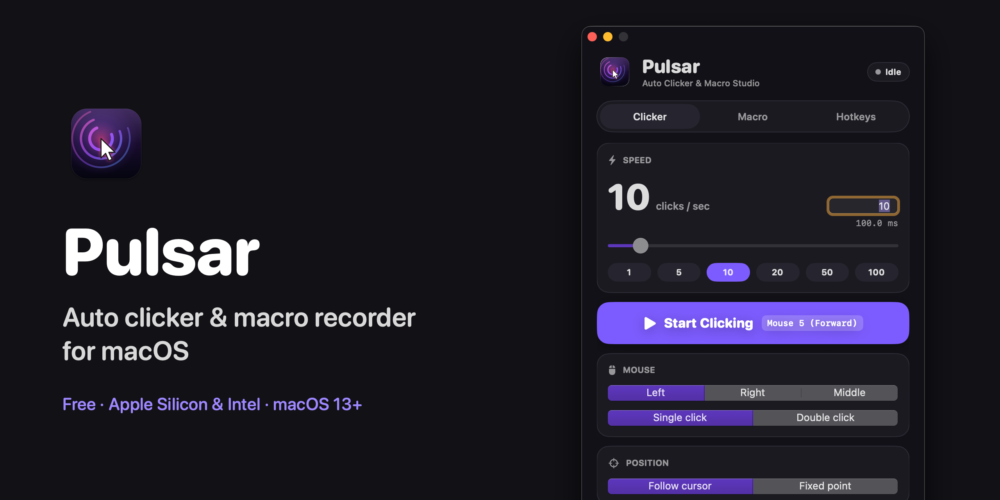

# Pulsar

An auto clicker and macro recorder for macOS and Windows.

- **macOS:** native SwiftUI, universal (Apple Silicon + Intel), macOS 13 Ventura or later.
- **Windows (beta):** native WPF, Windows 10 or 11 (64-bit), one portable `.exe` with nothing to install.



## Features

**Clicker**
- 0.1 to 500 clicks per second, set by slider, number field or presets
- Left, right or middle button; single or double click
- Click wherever the cursor is, or at a fixed point you pick on screen
- Stop after a number of clicks, a number of seconds, or never
- Optional ± random variation in timing so clicks look less robotic
- Never clicks on Pulsar's own window, so the Stop button always works

**Macros**
- Record clicks, drags, scrolling, keystrokes and (optionally) mouse movement
- Play back with a repeat count (or forever) at 0.25× to 4× speed
- Save macros to `.json` files and open them again later; the loaded macro's name is shown
- Keys or buttons held at the moment you stop playback are released

**Global shortcuts**
- Start/stop clicking: **F6**
- Play/stop macro: **F7**
- Start/stop recording: **F8**
- Rebind any of them to a key combo (e.g. ⌃S or Ctrl+S) or a mouse button, side buttons included
- Optional "hold to click" mode: clicks only while the shortcut is held down

Settings and your last macro are remembered between launches. A menu bar icon (macOS) or tray icon (Windows) gives quick access to start, stop and play.

## Install on macOS

1. Download `Pulsar.dmg` from the [latest release](../../releases/latest).
2. Open it and drag **Pulsar** into **Applications**.
3. Open Pulsar from Applications. Because the app isn't signed with an Apple Developer ID, macOS blocks it the first time:
   - **macOS 15 Sequoia and later:** click **Done**, then go to **System Settings → Privacy & Security**, scroll down and click **Open Anyway** next to Pulsar.
   - **macOS 13–14:** right-click Pulsar → **Open**, then click **Open**.

   Or, from Terminal:
   ```bash
   xattr -dr com.apple.quarantine /Applications/Pulsar.app
   ```

### Grant Accessibility access

Pulsar needs Accessibility permission to click and to hear your shortcuts anywhere on screen.

1. Go to **System Settings → Privacy & Security → Accessibility** (Pulsar's banner has an **Open Settings** button).
2. Turn **Pulsar** on. If it isn't listed, click **+** and choose `/Applications/Pulsar.app`.
3. The banner disappears within a second. If it doesn't, quit Pulsar from the menu bar icon and reopen it.

Always run the copy in `/Applications`, not the one inside the DMG.

## Install on Windows

1. Download `Pulsar.exe` from the [latest release](../../releases/latest) and put it anywhere, e.g. your Desktop.
2. Double-click it. The app isn't code-signed, so Windows SmartScreen may say "Windows protected your PC": click **More info → Run anyway**.

No permission setup is needed. Notes:
- **Closing the window keeps Pulsar running in the tray** so your shortcuts keep working. Right-click the tray icon → **Quit Pulsar** to exit.
- **Apps running as administrator** (some games and installers) ignore input from normal apps. To click or record in them, right-click `Pulsar.exe` → **Run as administrator**.
- Settings live in `%APPDATA%\Pulsar`. Macro files aren't interchangeable between the macOS and Windows versions.

## Usage

**Clicker tab:** set the speed, button, position and stop condition, then press **Start Clicking** or **F6**. To click a fixed spot, choose **Fixed point → Pick Location** and click anywhere on screen.

**Macro tab:** press **Record Macro** or **F8**, do what you want repeated, then press **F8** again to stop. Clicks on Pulsar's own window aren't recorded, so stop with the shortcut when recording in another app. Press **Play Macro** or **F7** to replay. Use **Save Macro…** and **Open Macro…** to keep several macros as files.

**Hotkeys tab:** click a shortcut, then press the key combo or mouse button you want. Left and right click need a modifier. Esc cancels.

> On laptops, function keys may need **fn** (e.g. fn+F6) unless "Use F1, F2, etc. keys as standard function keys" is on in Keyboard settings.

## Build from source

### macOS

Requires Xcode command line tools (Swift 5.9+).

```bash
git clone https://github.com/manisanghsharma/Pulsar.git
```

```bash
cd Pulsar && ./build.sh
```

This compiles a universal binary, renders the icon, and writes `build/Pulsar.app` and `build/Pulsar.dmg`. The app is ad-hoc signed against its bundle ID, so the Accessibility grant survives rebuilds.

For quick iteration you can also run `swift run`, but macOS then asks for Accessibility for your terminal instead of Pulsar.

### Windows

Requires the [.NET 8 SDK](https://dotnet.microsoft.com/download/dotnet/8.0).

```bash
dotnet publish windows/Pulsar.csproj -c Release -r win-x64 --self-contained true -p:PublishSingleFile=true -p:IncludeNativeLibrariesForSelfExtract=true -p:EnableCompressionInSingleFile=true -o out
```

This writes `out/Pulsar.exe`. GitHub Actions runs the same build on every push that touches `windows/`, and attaches the `.exe` to each published release.

## Project layout

| Path | What it holds |
|---|---|
| `Sources/Pulsar/PulsarApp.swift` | App entry, window and menu bar item |
| `Sources/Pulsar/AppModel.swift` | Settings, event tap, hotkeys, clicking, recording, playback, macro files |
| `Sources/Pulsar/Input.swift` | Triggers, macro events and the click/playback runner |
| `Sources/Pulsar/Views.swift` | All SwiftUI views and the color theme |
| `scripts/make_assets.swift` | Draws the app icon and the DMG background |
| `build.sh` | Builds the `.app` and `.dmg` |
| `windows/Model.cs` | Windows: settings, global hooks, hotkeys, clicking, recording, playback, macro files |
| `windows/Native.cs` | Windows: Win32 hooks and `SendInput` |
| `windows/MainWindow.xaml` | Windows: the window's layout; styles live in `App.xaml` |
| `.github/workflows/windows.yml` | Builds `Pulsar.exe` on GitHub Actions |
